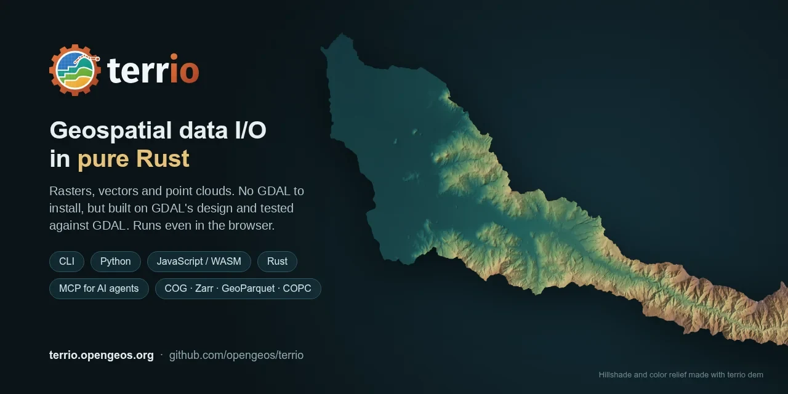

# terrio

**Pure-Rust geospatial raster, vector and point cloud data I/O.**



terrio reads, writes, converts and reprojects the geospatial formats most workflows use, without
C dependencies. It builds anywhere Rust does, WebAssembly included, and it is tested file by file
against [GDAL](https://gdal.org) on real-world data.

```sh
terrio info s3://sentinel-cogs/sentinel-s2-l2a-cogs/10/S/EG/2026/10/S2C_10SEG_20261010_0_L2A/B04.tif
terrio convert countries.shp countries.gpkg --where "CONTINENT = 'Europe'"
terrio warp dem.tif dem_utm.tif --t-srs EPSG:32613 -r bilinear
terrio rasterize counties.gpkg counties.tif -a FIPS --tr 0.01 0.01
```

## Features

- **Rasters**: GeoTIFF, Cloud Optimized GeoTIFF, JPEG 2000, Zarr v2/v3, netCDF (classic and
  netCDF-4, with groups), HDF5, ERDAS Imagine,
  ENVI, Esri grids, GeoPackage tiles, VRT and more. See [Formats](formats.md).
- **Vectors**: GeoPackage, GeoParquet, FlatGeobuf, Shapefile, GeoJSON (and GeoJSONSeq), CSV,
  KML/KMZ, GML, GPX, TopoJSON, MapInfo and OpenStreetMap PBF; layers larger than memory read and
  converted as streams of features.
- **HEC-RAS**: the 2D meshes, cross sections, structures and other features of HEC-RAS geometry
  and plan HDF files, with their stored attributes and results, as vector layers. See
  [HEC-RAS](hecras.md).
- **Point clouds**: LAS 1.0 to 1.4 (with waveforms), LAZ, COPC, PLY and E57, read and written,
  and EPT read; remote COPC and EPT read by bounds and octree level; files larger than memory in
  chunks; PDAL's filters (SMRF ground classification, outliers, ranges, sampling, voxels);
  gridding to DEMs as PDAL and `gdal_grid` do. See [Point Clouds](point-clouds.md).
- **Cloud data in place**: HTTP(S) range requests, `s3://`, `gs://` and `az://` objects, zip
  archives, and GDAL's `/vsicurl/`, `/vsis3/`, `/vsizip/` prefixes. Remote COGs are read window by
  window. See [Remote Data](remote-data.md).
- **GDAL-style operations**: `translate`, `warp` (14 resampling methods), `mosaic` and VRTs,
  `rasterize`, `polygonize`, and `convert` with OGR SQL filters. See [Command Line](cli.md).
- **Coordinate reference systems**: EPSG codes, WKT, PROJ strings and `.prj` files, identified and
  transformed the way GDAL does. See [Coordinate Systems](crs.md).
- **Three interfaces**: a [Rust library](rust.md), a [Python package](python.md) with NumPy arrays,
  and an [npm package](javascript.md) compiled to WebAssembly.

## How terrio relates to GDAL

terrio is not a port of GDAL. It covers the formats and operations that most geospatial workflows
need, with GDAL's behaviour as the reference: every driver and operation is compared with GDAL on
real files, and differences are treated as bugs. See [Testing Against GDAL](testing.md) and
[Coming from GDAL](gdal.md). For how terrio compares with the `gdal` crate, the GeoRust crates
and other Rust options, see [Why terrio?](why-terrio.md).

The format codecs and projections build on the pure-Rust crates of
[whitebox_next_gen](https://github.com/jblindsay/whitebox_next_gen) (`wbraster`, `wbvector`,
`wbprojection`); terrio adds its own drivers where those are wrong or missing.

## Status

terrio is in early development. The API may change before 1.0. See the
[roadmap](https://github.com/opengeos/terrio/blob/main/ROADMAP.md).

## License

MIT.
